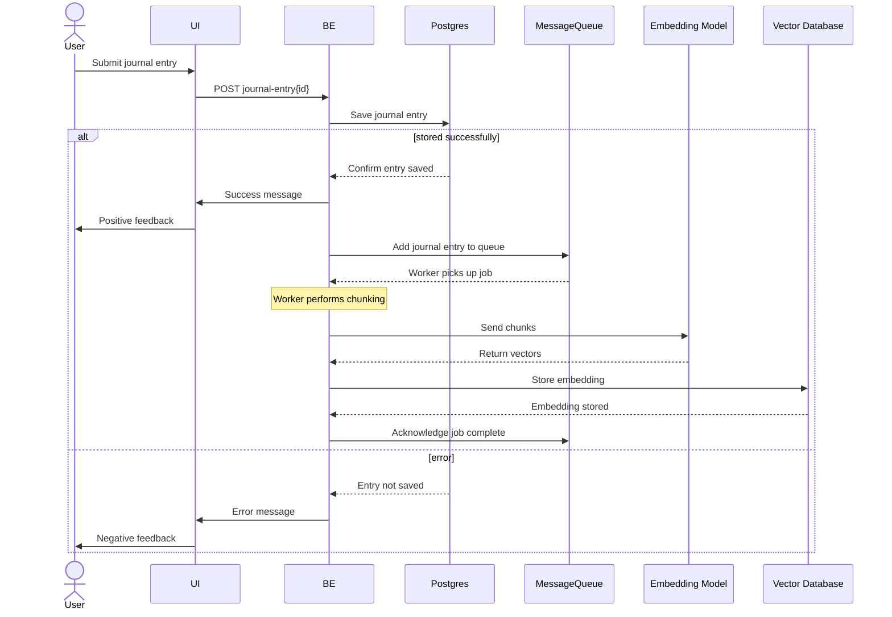

# Overview

This diagram shows the ingestion pipeline described in the [PRD, section 4.1](../product/prd.md). The entry is saved and confirmed to the user right away. Chunking and embedding happen afterwards in a worker that takes its jobs from a message queue.[^diagram-commits]

In the PRD, the "Vector Database" is pgvector inside the same Postgres instance. The diagram shows it as a separate participant only to make the steps clearer.

# Diagram

[^diagram-commits]: Originally `docs/sequence-diagram.mmd`, converted to an OKF document on 2026-11-22 without changing the diagram.
